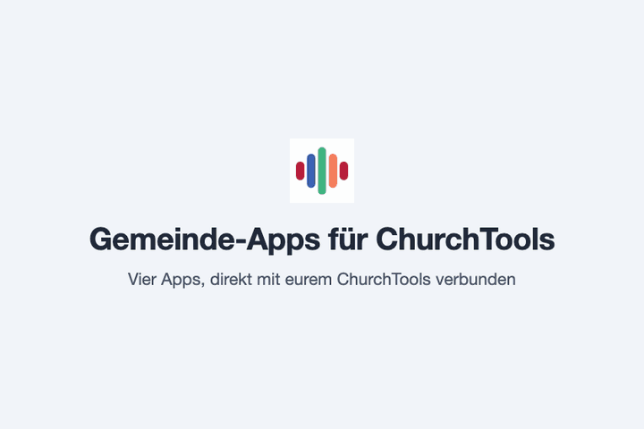
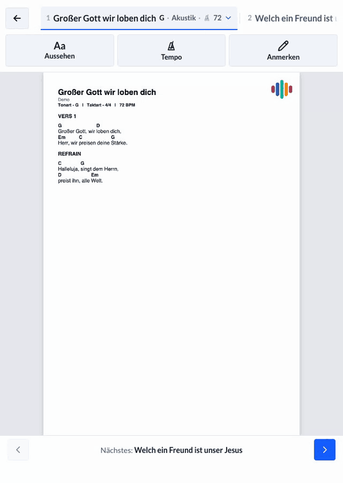
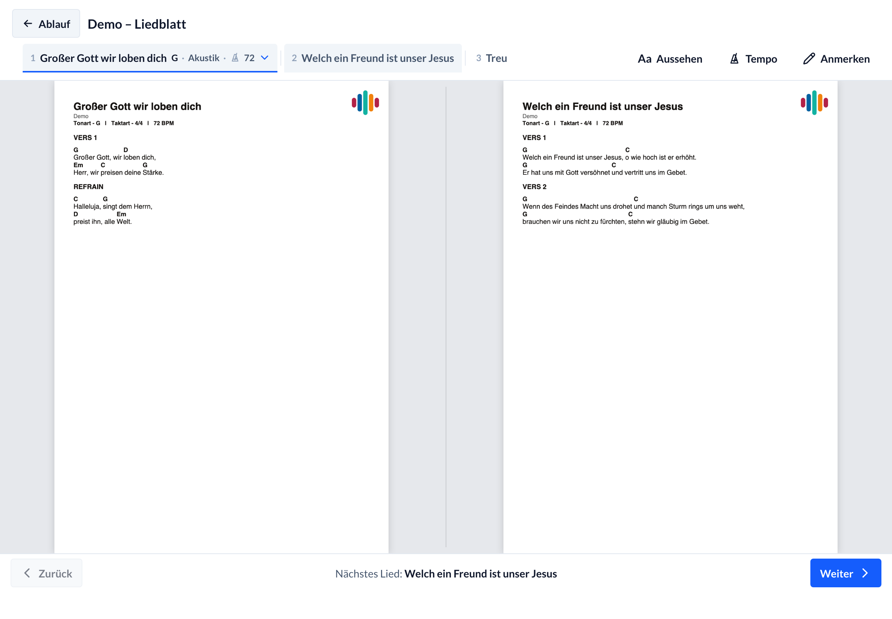
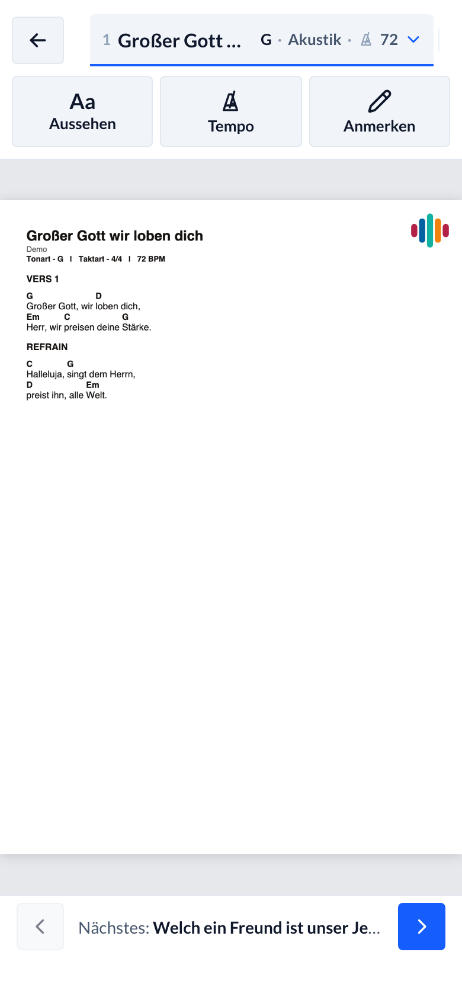
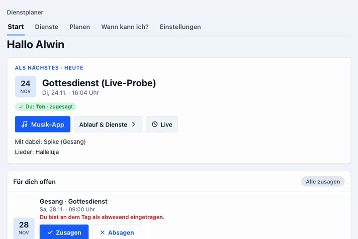
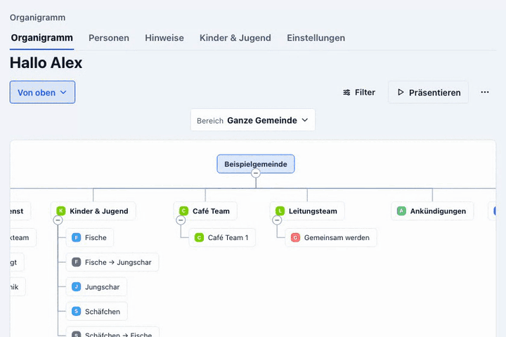
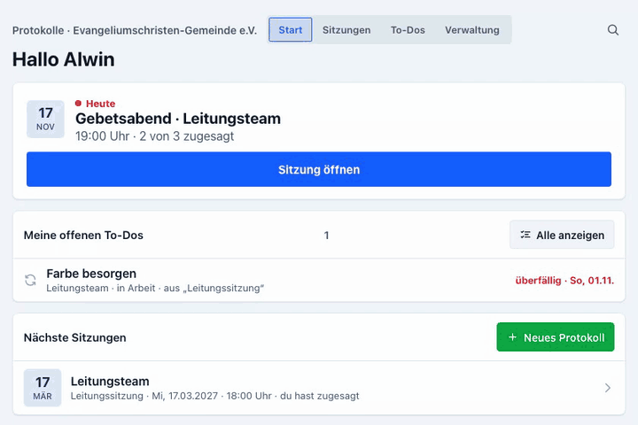
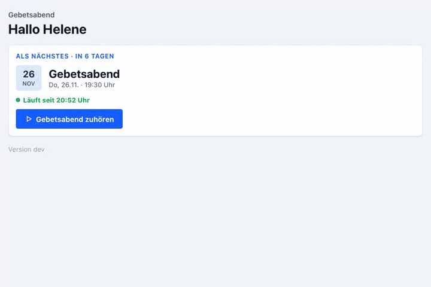

<p align="center">
  
</p>

<h1 align="center">Gemeinde-Apps für ChurchTools</h1>

<p align="center">
  Chord Charts, Dienstpläne, Organigramm, Protokolle und Gebetsabend – direkt mit eurem ChurchTools verbunden.<br>
  Kostenlos, quelloffen, ohne eigene Datenbank.
</p>

<p align="center">
  <a href="https://github.com/FAlwin/churchtools-gemeinde-apps/releases/latest"></a>
  
  <a href="LICENSE"></a>
</p>

<p align="center">
  <a href="https://github.com/FAlwin/churchtools-gemeinde-apps/releases/latest"><strong>Musik-App herunterladen</strong></a>
  &nbsp;·&nbsp;
  <a href="#die-apps">Alle Apps</a>
  &nbsp;·&nbsp;
  <a href="docs/betrieb/ERWEITERUNG.md">So installiert ihr sie</a>
</p>

<p align="center">
  
</p>

---

Die Apps holen ihre Daten aus dem ChurchTools eurer Gemeinde und schreiben dorthin zurück. Es gibt keine
zweite Datenbank und keine zentrale Stelle: Jede Gemeinde installiert die Apps selbst, jede Person meldet sich
mit ihren eigenen ChurchTools-Zugangsdaten an und sieht nur, was ihre Rechte erlauben.

> **Hinweis:** Dies ist ein **inoffizielles Community-Projekt** und steht in keiner Verbindung
> zur ChurchTools GmbH. „ChurchTools" ist eine Marke der jeweiligen Inhaber. Die Namen der Apps
> sind rein beschreibend gemeint („Musik-App **für** ChurchTools").

## Die Apps

Alle Apps gibt es als **ChurchTools-Erweiterung**: ein ZIP, das ihr in ChurchTools unter
_Administration → Erweiterungen_ hochladet. Die Musik-App läuft außerdem auf einem eigenen Server
(dann auch offline und als App auf dem Home-Bildschirm).

| App              | Wofür                                                                                 | Download                                                                                        | Anleitung                                                         |
| ---------------- | ------------------------------------------------------------------------------------- | ----------------------------------------------------------------------------------------------- | ----------------------------------------------------------------- |
| **Musik-App**    | Chord Charts der Setlist, automatisch transponiert; Ablauf, Lieder, Abwesenheiten     | [ZIP herunterladen](https://github.com/FAlwin/churchtools-gemeinde-apps/releases/latest)        | [Erweiterung](docs/betrieb/ERWEITERUNG.md) · [Server](INSTALL.md) |
| **Dienstplaner** | Dienste aller Gruppen planen, zusagen, tauschen; freie Plätze auf einen Blick         | [ZIP herunterladen](https://github.com/FAlwin/churchtools-gemeinde-apps/releases?q=dienstplan)  | [Anleitung](docs/betrieb/DIENSTPLANER.md)                         |
| **Organigramm**  | Bereiche, Gruppen und Leitung als Baum, Karten oder Mindmap – auch als PDF            | [ZIP herunterladen](https://github.com/FAlwin/churchtools-gemeinde-apps/releases?q=organigramm) | [Anleitung](docs/betrieb/ORGANIGRAMM.md)                          |
| **Protokolle**   | Sitzungsprotokolle mit Beschlüssen und To-Dos; die Leitung schreibt, die Gruppe liest | [ZIP herunterladen](https://github.com/FAlwin/churchtools-gemeinde-apps/releases?q=protokolle)  | [Anleitung](docs/betrieb/PROTOKOLLE.md)                           |
| **Gebetsabend**  | Gebetsabend als Audio-/Video-Übertragung nur für Mitglieder                           | [ZIP herunterladen](https://github.com/FAlwin/churchtools-gemeinde-apps/releases?q=gebetsabend) | [Anleitung](docs/betrieb/GEBETSABEND.md)                          |

**In Arbeit:** [Anmeldungen](docs/betrieb/ANMELDUNGEN.md) (Ersatz für Jotform & Co.).

## Musik-App

<p align="center">
  
</p>

Die Chord Charts der Setlist kommen direkt aus ChurchTools – in der Tonart, die im Ablauf steht.

- **Transponieren mit einem Tipp**, mit Kapo und eigenen Versionen eines Liedes (z. B. „Akustik“)
- **Ablauf bearbeiten**, Lieder suchen und einfügen, Notenblätter aus CCLI SongSelect holen
- **Anmerkungen** mit Stift und Marker, auf Wunsch mit dem Team geteilt
- **Am iPad zwei Seiten nebeneinander**, als PDF teilbar; mit eigenem Server auch offline im Saal

<table>
  <tr>
    <td width="72%"></td>
    <td width="28%"></td>
  </tr>
</table>

<details>
<summary><strong>Alle Funktionen im Detail</strong></summary>

- **Ablaufpläne & Setlists** aus ChurchTools anzeigen (kompletter Ablauf, nicht nur Lieder)
- **Ablauf bearbeiten** (mit dem ChurchTools-Recht dafür): Punkte und Lieder anlegen, ändern, löschen und
  per Ziehen sortieren, Vorlauf vor dem Beginn festlegen, Ablauf abschließen und wieder öffnen;
  Löschen und Verschieben lassen sich kurz danach **rückgängig** machen
- **Ablaufvorlagen** (unter **Mehr → Abläufe**): Vorlagen nach Kalender ansehen; mit dem ChurchTools-Recht „Ablaufvorlagen
  bearbeiten“ (je Kalender) anlegen, füllen, umbenennen und löschen – dieselbe Seite wie im Dienstplaner
- **Chord Charts als PDF** (SongSelect-Look) mit automatischer Transponierung, Kapo, Spalten- und
  Schrift-Optionen; im Querformat zwei Seiten nebeneinander, als PDF teil-/druckbar
- **Alle Lieder** durchsuchbar inkl. Nutzungs-Statistik (Häufigkeit / zuletzt gespielt, mit
  wählbarem Zeitraum). Gesucht wird in Titel und Autor, Titel-Treffer stehen vorn; findet der Titel
  nichts, lässt sich **auch im Liedtext** suchen – für den Fall, dass man nur eine Zeile kennt
- **Beim Einfügen eines Liedes: ein Suchfeld, eine Liste** – Titel, Autor oder CCLI-Nummer tippen, eigene
  Lieder oben, SongSelect darunter; jede Zeile mit Auge (Vorschau) und Plus (einfügen). Findet die
  Bibliothek nichts, sucht SongSelect von selbst mit – auch beim **Verknüpfen** eines Ablaufpunkts
  mit einem Lied
- **Liedtext-Vorschau vor dem Einfügen** – ein Antippen zeigt erst den Text, dann den Knopf zum
  Hinzufügen; so unterscheidet man gleichnamige Lieder, ohne sie zu öffnen. Bei SongSelect mit
  Abschnitten, Autoren und CCLI-Nummer. Für den Alltag bleibt der **„+"**-Knopf: sofort einfügen
- **Lieder anlegen** – über die Quelle **SongSelect** gefunden (Titel oder CCLI-Nummer; Autoren,
  Copyright und Tonart kommen mit, das Notenblatt gleich dazu) oder über „Neues Lied" selbst
  eingetippt. Aus dem Liederheft, direkt beim Ergänzen eines Ablaufs oder beim Verknüpfen. Trägt ein
  Lied der Bibliothek schon dieselbe CCLI-Nummer, fragt die App, ob das vorhandene verwendet werden soll
- **Stammdaten pflegen** – Name, Kategorie, Autor, CCLI-Nummer und Copyright eines vorhandenen Liedes
  ändern; Löschen mit Rückfrage, die die Folgen nennt
- **Live-Aktualisierung**: Änderungen am Ablauf erscheinen zeitnah bei allen; ein kurzer Hinweis unten
  nennt, was neu, geändert oder entfernt ist, und markiert die betroffenen Punkte für ein paar Sekunden
- **Mehrere benannte Lied-Versionen** (z. B. „Akustik", „Jugend") – team-weit in ChurchTools,
  Original bleibt erhalten. Der **Editor arbeitet in der Tonart, die gerade auf dem Blatt steht**;
  jede Version kennt ihre eigene Tonart
- **Anmerkungen, Zoom & Einstellungen pro ChurchTools-Konto** – geräteübergreifend synchronisiert
  (Stift/Marker/Text auf den Seiten, Rückgängig/Wiederholen); optional **mit dem Team teilen**
- **Offline-Reserve**: einmal geladene Abläufe/Charts sind ohne Netz im Saal verfügbar; als App
  installierbar (Home-Bildschirm)
- **Hochgeladene PDFs/Bilder** je Lied – direkt im durchgehenden Ablauf (mitwischen, im Querformat
  neben dem Nachbarlied) und ebenfalls mit Anmerkungen
- **Dateien eines Arrangements verwalten** – ansehen, aufs Gerät laden, hinzufügen und löschen,
  ohne den Umweg über die ChurchTools-Oberfläche
- **Arrangements verwalten** – Name, Quelle, Liednummer, Tonart, Tempo, Takt, Länge und Beschreibung
  im Stammdaten-Blatt ändern, weitere Arrangements anlegen, zum Standard machen, löschen mit Rückfrage
- **Notenblatt aus CCLI SongSelect holen** – wenn die Gemeinde die SongSelect-Integration in
  ChurchTools aktiviert hat und das Lied eine CCLI-Nummer trägt; in der Tonart des Arrangements
  (was dabei aufs SongSelect-Kontingent zählt: [docs/betrieb/songselect-kontingent.md](docs/betrieb/songselect-kontingent.md))
- **Abwesenheiten** – Musikerinnen und Musiker tragen je Termin per Häkchen oder als Zeitraum ein,
  wann sie fehlen; gespeichert wird direkt in ChurchTools. Termine lassen sich nach Art filtern
  (z. B. nur Gottesdienste); die Arten pflegt der Admin. Sichtbar für Mitglieder der gewählten
  Musikteam-Gruppen
- **Rechtebewusste Oberfläche** – jede Person sieht nur, wozu ihre ChurchTools-Rechte passen
- **Geführte Einführung** (Onboarding-Touren) beim ersten Öffnen
- **Frei konfigurierbare Links** (z. B. zu weiteren Gemeinde-Angeboten) im „Mehr"-Tab und optional
  auf der Login-Seite

</details>

**[Download](https://github.com/FAlwin/churchtools-gemeinde-apps/releases/latest)** · [Als Erweiterung installieren](docs/betrieb/ERWEITERUNG.md) · [Auf eigenem Server](INSTALL.md)

## Dienstplaner

<p align="center">
  
</p>

Ein Dienstplan für alle Dienstgruppen der Gemeinde – gespeichert in ChurchTools.

- **Startseite** mit dem nächsten Dienst samt Team und Liedern, offenen Anfragen und freien Plätzen
- **Zusagen, absagen, tauschen** mit einem Tipp; eigene Dienste als PDF teilen
- **Abwesenheiten** je Termin per Häkchen oder als Zeitraum eintragen
- **Planen** für Planer: Termine als Spalten, freier Platz → „Wer kann?“, Vorschläge per Zauberstab, „Wer wie oft?“

**[Download](https://github.com/FAlwin/churchtools-gemeinde-apps/releases?q=dienstplan)** · [Anleitung](docs/betrieb/DIENSTPLANER.md)

## Organigramm

<p align="center">
  
</p>

Die Gemeinde als Baum – Bereiche, Gruppen, Leitung und Personen, so wie die Gruppen in ChurchTools stehen.

- **Fünf Ansichten:** Karten, Liste, von oben, von links und Mindmap – auf Wunsch mit den Personen
- **Präsentation** im Vollbild und **PDF** zum Drucken
- **Offene Plätze** je Gruppe auf einen Blick
- Für Gruppen-Admins: **Gruppen umhängen und anlegen**, Leitung und Mitglieder pflegen

**[Download](https://github.com/FAlwin/churchtools-gemeinde-apps/releases?q=organigramm)** · [Anleitung](docs/betrieb/ORGANIGRAMM.md)

## Protokolle

<p align="center">
  
</p>

Sitzungsprotokolle für Gruppen wie den Leitungskreis – geschrieben wie in Word oder Notion, gespeichert in ChurchTools.

- **Protokoll schreiben** mit Tagesordnung, Beschlüssen, Terminen und To-Dos; mehrere sehen, wer gerade schreibt
- **To-Dos und Beschlüsse sammeln sich von selbst:** Liste oder Board, Suche über alle Protokolle
- **Nächste Sitzung festlegen** mit Einladung, Anwesenheit aus den Zusagen, Protokoll **freigeben** und als **PDF teilen**
- **Mit KI füllen:** aus einem Transkript Vorschläge machen lassen – Namen bleiben dabei im Browser

**[Download](https://github.com/FAlwin/churchtools-gemeinde-apps/releases?q=protokolle)** · [Anleitung](docs/betrieb/PROTOKOLLE.md)

## Gebetsabend

<p align="center">
  
</p>

Der Gebetsabend für alle, die nicht kommen können – mit Bild und Ton, nur für Gemeindeglieder mit ChurchTools-Zugang.

- **Zuhören mit einem Tipp** – die Seite merkt selbst, wann die Übertragung läuft
- **Die Technik startet und beendet** die Übertragung direkt in der Seite, mit Bild oder nur Ton, und sieht, wer zuhört
- **Kein eigener Server**, kein Link zum Weitergeben: übertragen wird von Browser zu Browser (VDO.Ninja)

**[Download](https://github.com/FAlwin/churchtools-gemeinde-apps/releases?q=gebetsabend)** · [Anleitung](docs/betrieb/GEBETSABEND.md)

Alle Bilder und Videos zeigen Beispieldaten aus dem Demo-Modus der Apps.

## Für andere Gemeinden

Jede Gemeinde betreibt ihre **eigene, eigenständige Instanz** – mit ihrer ChurchTools-Verbindung
und ihrem Gemeindenamen. Es gibt **keine zentrale Infrastruktur** und keinen geteilten Zugang:
Jede App spricht ausschließlich mit dem ChurchTools der eigenen Gemeinde, jede Person meldet sich
mit ihren **eigenen ChurchTools-Zugangsdaten** an.

Anpassbar sind nur:

| Was                                          | Wo                              |
| -------------------------------------------- | ------------------------------- |
| ChurchTools-URL, Session-Secret, Admin-Recht | `.env` auf eurem Server         |
| Gemeindename + eigene Links                  | in der App (Admin → „Mehr"-Tab) |
| Liedblatt zuerst als Akkorde oder PDF        | in der App (Admin → „Mehr"-Tab) |

Optik und Funktionen sind für alle identisch (eine gemeinsame Codebasis).

**Ohne eigenen Server?** Die App gibt es auch als **ChurchTools-Erweiterung** – ein ZIP, das ihr in
ChurchTools hochladet; angemeldet ist man dann über ChurchTools selbst. Sie kann weniger (kein Offline,
keine Suche im Liedtext) und läuft nur im Browser, nicht in der ChurchTools-App:
**[Anleitung zur Erweiterung](docs/betrieb/ERWEITERUNG.md)**.

## Schnellstart

Die App läuft als fertiges Docker-Image – kein eigener Build nötig:

```bash
# 1. Verteilpaket aus dem Ordner deploy/ holen (docker-compose.yml + .env.example)
# 2. .env ausfüllen (eigene ChurchTools-URL + Session-Secret)
docker compose up -d
```

Ausführliche Anleitung: **[INSTALL.md](INSTALL.md)** · Updates: **[UPDATE.md](UPDATE.md)**

## Lizenz & Haftung

Veröffentlicht unter der **[MIT-Lizenz](LICENSE)** – Nutzung, Anpassung und Weitergabe sind frei.
Die Software wird **ohne jede Gewährleistung** bereitgestellt (siehe Lizenztext).

Jede Gemeinde ist für ihre eigene Instanz, ihren ChurchTools-Zugang und die **Einhaltung der
DSGVO** selbst verantwortlich.
